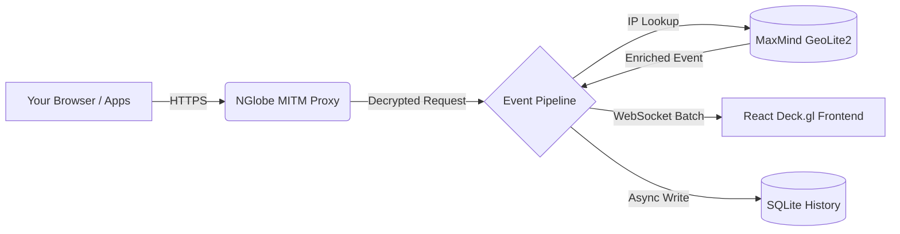

<div align="center">
  

  <h1>NGlobe</h1>
  <p><b>A beautiful, real-time 3D visualization of your machine's network traffic.</b></p>

  <p>
    <a href="https://pypi.org/project/nglobe/"></a>
    <a href="https://pypi.org/project/nglobe/"></a>
    <a href="https://github.com/shashwat/nglobe/blob/main/LICENSE"></a>
  </p>
</div>

<br/>

## The Problem

Tools like Wireshark and Fiddler are incredibly powerful, but they present network traffic as endless, dense rows of text. They lack **spatial context**. When your machine communicates with the outside world, it's hard to intuitively grasp *where* your data is going, *how much* is being sent, and *how fast* the connections are occurring.

## Why NGlobe?

**NGlobe** transforms invisible network packets into a stunning, interactive 3D globe. By intercepting your local traffic and mapping it geographically in real-time, NGlobe gives you a visceral understanding of your machine's digital footprint. 

Watch packets fly across the globe as lasers, instantly see tracking requests routed to remote continents, and monitor your system's global connections—all through a zero-configuration, one-click installation process.

---

## Features

- 🌍 **Interactive 3D Globe**: Built with Deck.gl and MapLibre for buttery-smooth 60fps rendering.
- 🚀 **Real-time Particle System**: Every network request is visualized as a physical particle flying to its destination server.
- ⚡ **Zero-Configuration**: Double-click `NGlobe.exe`. Proxy settings are handled for you and GeoIP data is bundled; the HTTPS certificate is optional.
- 🔍 **Live Traffic Interception**: Powered by `mitmproxy` to capture both HTTP and decrypted HTTPS traffic.
- 📊 **Rich Analytics**: View exact IPs, autonomous systems (ASN), hostnames, and transfer volumes in a sleek sidebar.

## Architecture



## Technology Stack

- **Backend**: Python 3.10+, FastAPI, Mitmproxy, SQLite
- **Frontend**: React, TypeScript, TailwindCSS, Zustand
- **Visualization**: Deck.gl, MapLibre GL JS, Framer Motion

---

## Installation & Quick Start

**Just run it:** double-click `NGlobe.exe`. Your browser opens on the globe and traffic starts flowing in.
Close the console window to stop. Your Windows proxy settings are put back automatically,
even after a crash (on the next launch).

**Build the exe yourself** (needs Python 3.10+ and Node.js): double-click `build.cmd` → `dist\NGlobe.exe`.

**Or run from source:**

```bash
cd frontend && npm ci && npm run build && cd ..   # builds the UI into src/nglobe/ui
pip install -e .
python -m nglobe                                   # or: nglobe
```

### First run

- **Works immediately.** NGlobe maps every connection your machine makes (host, IP, city, network owner).
  GeoLite2 databases are bundled, so there's nothing to download.
- **Optional: full HTTPS detail.** Click *Trust Certificate* in the wizard (or *Enable HTTPS details* in the
  top bar later) to also see each request's path, status and size. Windows asks you to confirm; no admin rights
  needed. Apps that refuse interception (certificate pinning) switch to pass-through automatically instead of breaking.

### Configuration

Optional. Copy `src/nglobe/config.toml` to `~/.nglobe/config.toml` and edit it, or use environment variables
such as `NETWORKGLOBE_SERVER__PORT=9000`. The database, logs and downloaded GeoIP data live in `~/.nglobe/`.

---

## Roadmap

- [ ] Support for macOS and Linux proxy auto-configuration.
- [ ] Protocol filtering (e.g., only show REST API calls).
- [ ] Historical playback mode (scrub through past traffic).
- [ ] Custom particle colors based on payload size or HTTP status code.

## Performance

NGlobe is engineered for extreme throughput. The backend utilizes asynchronous pipelines and SQLite batching, while the frontend employs a WebSocket event buffer that batches state updates. This allows NGlobe to render hundreds of concurrent connections per second without lagging the browser.

## Contributing

We welcome contributions! Please see our [Contributing Guide](CONTRIBUTING.md) for details on how to set up the development environment, build the frontend, and submit Pull Requests.

## FAQ

**Q: Does NGlobe send my data anywhere?**  
A: **No.** The proxy runs on `127.0.0.1`, the SQLite database lives in `~/.nglobe`, the UI is served locally, and IP lookups use offline databases. The one outbound call NGlobe makes itself is to `api.ipify.org`, once per run, to find your public IP for the globe's starting point. Set `location.auto_detect = false` to turn it off. (Map tiles load from CARTO.)

**Q: Why do I need to install a certificate?**  
A: You don't have to. Without it, NGlobe still sees every connection's host and destination. With it, NGlobe decrypts HTTPS locally (as a man-in-the-middle proxy) to also show each request's path, status and size.

## License

This project is licensed under the MIT License - see the [LICENSE](LICENSE) file for details.
