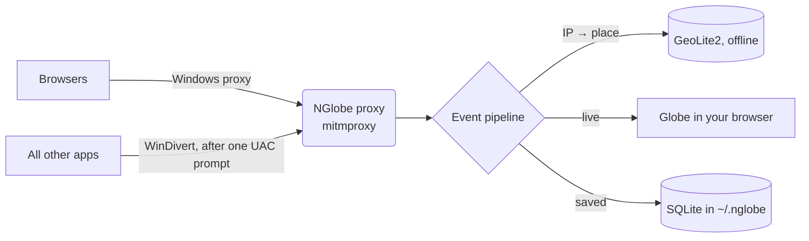

<div align="center">
  

  <h1>NGlobe</h1>
  <p><b>See where your internet traffic goes, live on a globe.</b></p>

  <p>
    <a href="https://github.com/Shashwat-Gupta57/NGlobe/releases/latest"></a>
    
    <a href="LICENSE"></a>
  </p>
</div>

Every time your PC talks to the internet, NGlobe draws a little laser from you to wherever that server
actually is: a CDN in Frankfurt, an ad tracker in Virginia, a game server in Singapore. It's a fun thing to
leave open for ten minutes once a month and go "huh, *that* app talks to *there*?"

## Install

1. Download **`NGlobe-Setup.exe`** from the [latest release](https://github.com/Shashwat-Gupta57/NGlobe/releases/latest).
2. Run it and click **Install**. No admin rights are needed. It installs for your user only (about 150 MB).
3. NGlobe opens in your browser. Windows asks once for admin permission so NGlobe can see **all apps**,
   not just browsers. You can say no and it still works for browsers.

Windows SmartScreen may warn because the installer isn't code-signed. Click *More info → Run anyway*.

**To stop NGlobe**, close its console window. Your Windows proxy settings are put back automatically, even if
it crashes (on the next launch).

**To uninstall**, use *Settings → Apps → NGlobe → Uninstall* or *Start menu → Uninstall NGlobe*. It removes
everything: the program, your saved history, logs, its certificate and its settings. Nothing NGlobe-related is
left on the PC.

## What you can do

| In the top bar | What it does |
|---|---|
| **All apps / Browsers only** | Shows what's being captured. *All apps* means the admin prompt was accepted. |
| **HTTPS details: off/on** | Off: you see every connection (host, IP, city, network owner, bytes). On: NGlobe's own certificate is trusted, so you also see each browser request's path, status code and size. Click again to remove the certificate. |
| **History 1.2 MB ✕** | How much history NGlobe has saved. Click to wipe it. |

Click any dot on the globe to see who's there. The sidebar lists live connections, and the analytics panel
shows top countries, networks and hostnames.

## How it works (short version)



- **Browsers** reach NGlobe through the Windows proxy setting, which NGlobe sets on launch and restores on exit.
- **Other apps** (games, Discord, Spotify, CLI tools…) are captured with mitmproxy's *local mode*, which needs
  that one admin prompt per launch. Their traffic is **never decrypted**, only relayed and measured, so nothing
  breaks.
- **HTTPS details** use a certificate generated fresh on *your* PC ("NGlobe"), never shared with anyone. Apps
  that refuse it (certificate pinning) automatically fall back to pass-through.

More detail, including config, file locations, building from source and troubleshooting, is in
**[docs/HOW-IT-WORKS.md](docs/HOW-IT-WORKS.md)**.

## Build it yourself

Needs Python 3.10+ and Node.js. Double-click **`build.cmd`** and you get `dist\NGlobe-Setup.exe`.

Or run from source:

```bash
cd frontend && npm ci && npm run build && cd ..   # builds the UI into src/nglobe/ui
pip install -e .
python -m nglobe
```

## FAQ

**Does NGlobe send my data anywhere?**
No. Everything stays on your PC. The only things it fetches are your public IP from `api.ipify.org` (once per
run, to place *you* on the globe; set `location.auto_detect = false` to turn it off) and the map tiles from
CARTO.

**Firefox shows certificate errors with HTTPS details on.**
Firefox 120+ trusts Windows' certificates automatically. On older versions, open `about:config` and set
`security.enterprise_roots.enabled` to `true`, or just leave HTTPS details off.

**Something stopped connecting while NGlobe was open.**
Close NGlobe, and the proxy is restored instantly. If an app pins certificates, it's put on pass-through after
its first failed attempt, so retrying usually works.

## Legal-ish stuff

This product includes GeoLite2 data created by MaxMind, available from
[https://www.maxmind.com](https://www.maxmind.com). The bundled copy may be a few months old, so a server might
be placed in the wrong city now and then.

To MaxMind, CARTO, the mitmproxy folks and anyone else whose excellent work is in here:
**pls gng don't take legal action this iis just a weekend project** 🙏
It's free, it's open source, and nobody is making a single rupee off it.

## License

MIT. See [LICENSE](LICENSE).
